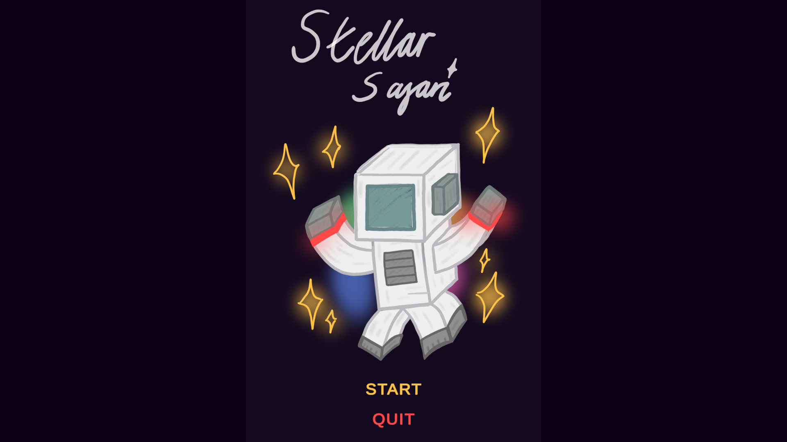
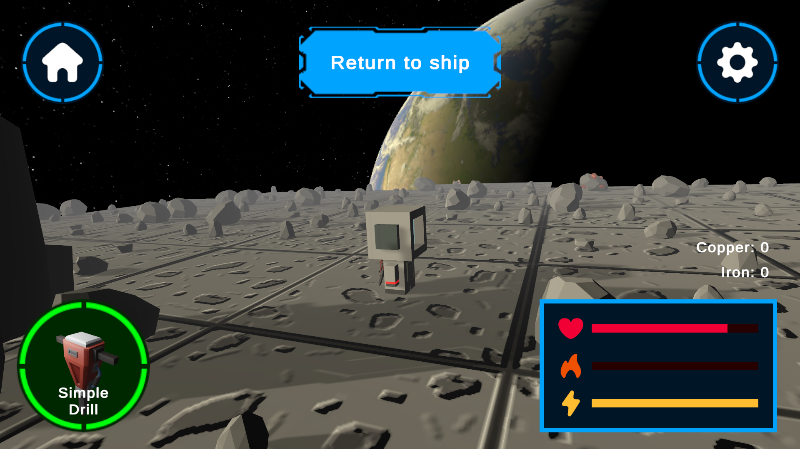
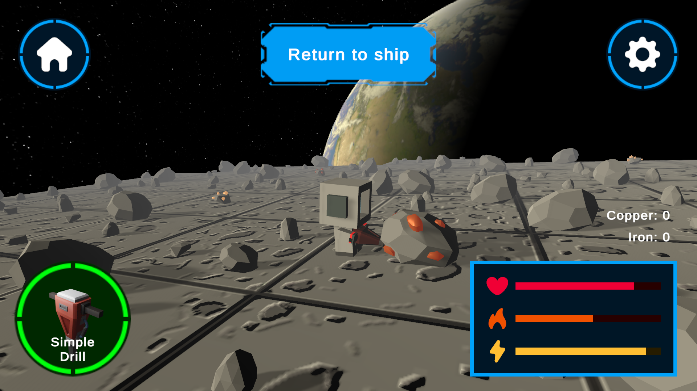

# Stellar Safari

*A game set in space about resource management and exploration.*

## Preview Screenshots

## How did I come up with this project?

This was originally just a passion project that I had undertaken, but as with many projects I have started it was put on the backburner purely due to a lack of time to work on it.

Through the StarDance competition, I was able to rekindle this idea and improve upon it further than I ever initially intended to, adding new features that can be seen below.

## Features:

- Grid-based movement system
- Object pooling
- Tile generation
- Ore mining
- Ore durability
- Ore drops
- Planet exploration
- Ore detection
- Drill progression
- Different probabilistic drop rates
- Random map generation
- SFX and Music
- Drill Upgrades
- Heat system
- Energy system
- Quick teleport to ship

## Design

The game was originally designed for mobile devices, and that is still the intended audience but for the meantime, keeping the demo oriented to computers was more convenient.

All of the tiles, textures and models have been designed by me - this is what was the most time-consuming part of the project but taught me a lot about how to use programs such as Blender for 3D design.

Sticking with the space theme meant I wanted the player to have some sort of backstory (although this unfortunately isn't really seen in the demo but will be expanded on in future updates).

The organisation which sent the player is known as the Stellar Frontier Agency... and that's about as far as I got for the time being.

## Challenges and Improvements

The main challenges I had were implementing the different systems in such as way that they would work together. For example I had the initial tile generation system done, but when I wanted to add a way to spawn in ores, I had to then go back and add ways of doing this. This often constituted making lots of managers to handle different events in the game such as PlayerInteraction, WorldObjectManager, etc.

Another challenge (which I had kinda placed on myself) was the fact that I was planning on releasing the game for mobile devices. This resulted in a whole batch of other issues such as making sure the game was optimised enough which led me to make an object pooling system. Also making sure the UI was suited for mobile was a whole other issue.

Despite the problems that the project had faced, I am happy with the state that it is currently in.

[Aperture favicon](https://commons.wikimedia.org/wiki/File:Aperture_Science.svg)
